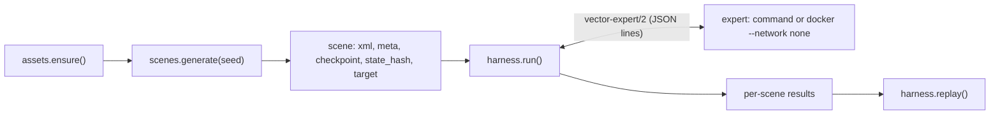
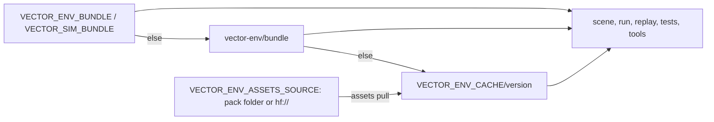
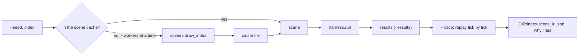
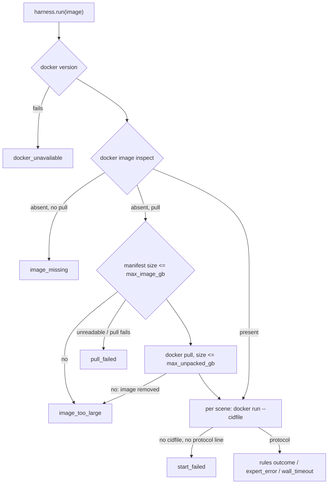

# vector-env

The Vector bin-picking environment: the scene generator, the versioned asset bundle, the task rules and the
`vector-expert/2` step harness. The simulator (vector-sim) runs here, outside the expert; the expert runs as a
local command or a docker image with no network and answers with control rows step by step.



## Setup

```bash
git clone https://github.com/robotensor/vector-env && cd vector-env
scripts/setup.sh            # vector-sim next to this folder (cloned at the pinned tag if missing), .venv, Node parts, the asset bundle
```

`setup.sh` clones vector-sim at `VECTOR_SIM_REF`, the tag `ARG VECTOR_SIM_REF=` in `example/Dockerfile` (now
`v0.1.0`): one pin, so local runs, the example image and the round's harness use the same simulator. A vector-sim
already beside this folder is kept; when it is a git checkout at another commit, setup prints a warning with the
`git checkout` that fixes it. `VECTOR_SIM_REF=<tag, branch or sha>` overrides the pin, `VECTOR_SIM_GIT` the repository.

Python 3.12 (`requires-python >=3.12`, `.python-version`), Node 22 or newer (`.nvmrc`: 24). `setup.sh` uses `uv`
when it is installed, else `python3 -m venv`; `requirements.lock` pins every package with its hashes and is installed
with `--require-hashes`. Miners usually get this package through vector-miner's `scripts/setup.sh`.

The asset bundle is pinned by `assets.version` and `assets.sha256` in `vector_env/env.yaml` and downloaded from
`assets.source` or `VECTOR_ENV_ASSETS_SOURCE` (`hf://<repo>[@rev]` or a folder made by `vector-env assets pack`).
`assets.source` is empty until the download location is published with the subnet, so setup finishes without a
bundle and prints how to get it. Then:

```bash
VECTOR_ENV_ASSETS_SOURCE=<asset-source> .venv/bin/vector-env assets pull
.venv/bin/vector-env assets info [--verify]      # the folder in use (~/.cache/vector-env/assets/<version>), version, sha256
.venv/bin/vector-env assets dir                  # just the folder (exit 2 when there is none)
```

A folder source is what `vector-env assets pack --out <dir>` writes, one subfolder per version:

```
<dir>/<version>/assets.json      the manifest (its sha256 is assets.sha256)
<dir>/<version>/bundle.tar       the bundle's files
```

A bundle folder itself (the one with `manifest.json`, `robot/`, `library/`, ...) is not a source: use it with
`VECTOR_ENV_BUNDLE=<folder>`, or pack it first.

`assets pull` refuses a version that is not letters, digits, `.`, `_` and `-` (starting with a letter or digit, at
most 64 characters), a manifest path that is absolute or has `.`/`..`/empty segments, and an archive member the
manifest does not list; `assets info --verify` also reports files in the folder that the manifest does not list.
A version other than the pinned one has no sha256 to check its manifest against: the pull logs a warning.

Where the bundle is looked for, in order (the one rule every tool and test suite of the Vector repos uses):

1. `VECTOR_ENV_BUNDLE` (or `VECTOR_SIM_BUNDLE`), a bundle folder;
2. `<vector-env>/bundle`, a bundle folder in this checkout (gitignored);
3. `VECTOR_ENV_CACHE/<version>` (default `~/.cache/vector-env/assets/<version>`), where `assets pull` puts it;
   `<version>` is `VECTOR_ENV_ASSETS_VERSION` or `assets.version`.

`VECTOR_ENV_CACHE` moves the download cache. `scene`, `run` and `replay` all need the bundle; without one they
print one line saying how to get it and exit 2. In Python, `assets.find()` returns the folder or `None`; in
JavaScript, `findBundle()` from `@vector/sim/bundle.js` follows the same order (it reads `assets.version` from
`VECTOR_ENV_DIR`, default `../vector-env` beside vector-sim).



## CLI

```bash
vector-env scene --seed 7 [--summary] [--draw JSON]
vector-env run --command "node example/solve.mjs" --scenes 20 --seed 1 [--workers 4] [--results FILE] [--stderr DIR]
               [--trace DIR] [--scene-cache DIR | --no-scene-cache]
vector-env run --image ghcr.io/<you>/<repo>@sha256:<digest> --scenes 20 --seed 1 [--pull] [--time-limit 15] [--wall 45]
               [--cpus 4] [--memory 8g] [--docker docker] [--draw JSON]
vector-env replay --scene scene.json --result result.json [--time-limit 15] [--trace FILE]
vector-env assets pull [--version V] [--source S] [--force] | dir | info [--verify] | manifest --version V | pack --out DIR
```

- `run --results FILE` writes one JSON line per scene (outcome, robot time, the rows sent as `ctrl` and `n`, timings,
  `infra`).
- `run --stderr DIR` writes the expert's stderr of every scene to `DIR/<index, 4 digits>-<scene_id>.log`, e.g.
  `0000-s121011998878783-4a5b69a2.log`.
- `run --pull` pulls the image only when it is not on this machine, within the size limits below.
- `run --workers N` runs N scenes at a time and also generates N scenes at a time. Generating a scene (settling the
  parts) takes about 2 s and dominates short runs, so `run` keeps every generated scene in a cache folder and reuses
  it on the next run with the same seed: `~/.cache/vector-env/scenes/<env version>/<assets sha256>/<draw key>/<seed>/<index>.json`
  (also the indexes none of whose draws places a scene). `--scene-cache DIR` or `VECTOR_ENV_SCENE_CACHE=DIR` moves
  it, `--no-scene-cache` or `VECTOR_ENV_SCENE_CACHE=off` turns it off; delete the folder to clear it. The summary
  shows `generate_s`, `scenes_cached` and the `scene_cache` folder. Compare variants of your expert on the same
  `--seed`: they then run on the same scenes, and only the first run generates them.
- `run --trace DIR` replays every scene after the run and writes `DIR/<index, 4 digits>-<scene_id>.json` (below);
  for each failed scene it prints a `why` line.
- `replay` re-simulates a stored result's rows on its scene and prints the outcome; `--trace FILE` also writes the
  scene's trace and prints why it ended.
- `--draw` overrides the random draw (`draw` in `vector_env/env.yaml`) to experiment; the round uses the defaults.

### Inspect a failure



```bash
.venv/bin/vector-env run --command "node example/solve.mjs" --scenes 30 --seed 1 --workers 4 --results r.jsonl --trace traces
#   why s27260578352828-f7734b96: timed_out at tick 300 (15 s): 15 s | the expert sent 300 rows | the gripper first
#   touched the target (part 1) at tick 51 | ... | the target was held for 18 ticks (ticks 52-69); it was not held
#   from tick 70 | its lowest point got to 202.3 mm below the lift line (the bin rim + 0.05 m) at tick 69

.venv/bin/vector-env scene --seed 27260578352828 > scene.json          # the scene again (its seed is in the scene_id)
.venv/bin/vector-env replay --scene scene.json --result r.jsonl --trace one.json
```

A trace (`format: vector-env-trace/1`) re-simulates the result's rows with the round's rules and records:

| field | what |
|---|---|
| `outcome`, `tick`, `t`, `detail`, `part`, `hash` | the rules' verdict (the same as `replay`) |
| `rows`, `sent`, `held` | rows stepped before the verdict, rows the expert sent, ticks the last row was held after them |
| `reasons` | why it ended, in words: the verdict, the rows, first touch of the target, when the rows close the grip and whether the fingers shut on nothing, when the target was held, how high its lowest point got against the lift line, parts that left the bin. When the harness ended the scene itself (`expert_error`, `wall_timeout`) the first reason says so |
| `summary` | the same as numbers: `target_first_touch`, `target_held` (tick ranges), `other_held`, `grip_first_asked`, `grip_first_shut`, `shut_on_nothing`, `target_max_above_line_mm`, `target_held_above_line_ticks`, `nearest_mm`/`nearest_tick` (tcp to the target's center), `left_bin` |
| `ticks[k]` | per tick (0 = the start): `row` (the 7 values stepped), `q` (arm joints, rad), `grip` (0..1), `shut` (the fingers fully closed), `tcp` (m, world), `tcp_quat` (w, x, y, z), `held` (parts between both pads), `touch` (parts touching the gripper), `target` (`pos`, `above_line_mm`, `inside`, `dist_mm`); `after_rows` marks ticks after the expert's last row |
| `lift_line_z`, `hold_s`, `tick_s`, `time_limit_s`, `target`, `result` | the rule constants of the scene, and the run's own result when one was given |

A success needs the target held between both pads, its lowest point above `lift_line_z` (the bin rim +
`lift_clear`) and no other part above it, for `hold_s` in a row. `harness.trace(scene, ctrl, n, time_limit_s=15,
result=r)` returns the same in Python.

## Python

```python
from vector_env import scenes, harness, rules, assets

sc, err = scenes.draw_index(7, 0)       # index 0 of seed 7, retried like the round (None, err when no draw places one)
res = harness.run({"command": ["node", "example/solve.mjs"]}, [sc], time_limit_s=15, wall_s=45)
harness.replay(sc, res[0]["ctrl"], res[0]["n"], time_limit_s=15)
harness.trace(sc, res[0]["ctrl"], res[0]["n"], time_limit_s=15, result=res[0])
```

`scenes.generate(seed)` makes the scene of one exact seed and raises `SceneError` on the few seeds whose parts
cannot be placed; `scenes.draw_index(seed, index)` (and `draw_scene(seed0)`) try the next seeds as the round does.

For images: `harness.run(..., pull=True)` pulls a missing image first; `harness.ensure_image(image)`,
`harness.pull(image)` (always pulls, raising `PullFailed`, `ImageTooLarge` or `DockerUnavailable`, all
`HarnessError` with an `outcome`), `harness.image_size(image)` (bytes on this machine, `None` when absent),
`harness.manifest_size(image)` and `harness.remove_image(image)` (to prune after a round) are there for callers.

## Outcomes

Every result has `outcome` and `infra`. The pick rules give `success`, `missed`, `slipped`, `knocked_out`,
`timed_out`, `wrong_part` (`rules.OUTCOMES`). The harness adds two groups (`rules.EXPERT_OUTCOMES`,
`rules.INFRA_OUTCOMES`; `INFRA_OUTCOMES` also exported by the JS side):

| outcome | `infra` | meaning |
|---|---|---|
| `expert_error` | no | the expert broke the protocol, gave up, exited, or the container exited after it was created |
| `wall_timeout` | no | no verdict within the scene's wall budget |
| `image_too_large` | no | the image's manifest (compressed) is above `harness.docker.max_image_gb`, or the pulled image is above `max_unpacked_gb` (it is removed again) |
| `docker_unavailable` | yes | no docker binary, or the daemon does not answer |
| `image_missing` | yes | the image is not on this machine and `pull` was not asked for |
| `pull_failed` | yes | the manifest could not be read, or `docker pull` failed or ran past `pull_timeout_s` |
| `start_failed` | yes | the expert command could not be started, or docker never created the container (no `--cidfile` written: daemon error, bad option, image pruned meanwhile) |
| `scene_error` | yes | the scene does not restore to its state hash (not the expert's doing) |
| `harness_error` | yes | the harness itself crashed |

`infra: true` results say nothing about the expert: re-run them rather than score them. Only signals the expert
cannot fake decide this (the container's own exit code, 125 included, stays `expert_error`); a container that was
created but failed to start counts as `expert_error`. `harness.summary()` counts them in `infra`. Before an image
runs, `harness.run` checks the daemon (`docker version`) and the image (`docker image inspect`); when either fails
every scene gets the same infra outcome without running.



## vector-expert/2

One JSON object per line on the expert's stdin and stdout.

```
-> {"type":"start","format":"vector-expert/2","scene":{scene_id,xml,meta},"checkpoint","state_hash","target",
    "tick":0,"t":0,"qpos","qvel","obs":{width,height,camera,depth,seg,rgb},"limits":{time_limit_s,control_hz,tick_s,max_rows}}
<- {"type":"act","rows":[[q1..q6,grip],...],"obs":false}
-> {"type":"state","tick","t","qpos","qvel","obs"?}
-> {"type":"end","outcome","t","tick"}
```

- A row is 6 arm joint targets (rad) and the grip, 0 (open) to 1 (closed); one row per tick of 1/20 s.
- `rows: []` holds the last row until the rules decide. `"obs": true` adds an image to the next state.
- `{"type":"error","error":"..."}` gives up. Anything else on stdout ends the scene as `expert_error`.
- The try ends at the rules' verdict or at `time_limit_s` of robot time (`timed_out`); the scene's wall budget ends
  it as `wall_timeout`.
- What an expert writes is bounded: a message is at most 1 MiB, at most 4 messages wait unanswered, at most 64 MiB
  in all, and it may leave at most 16 MiB of its input unread. Past any of these the scene ends as `expert_error`
  (`harness.io` in `vector_env/env.yaml`).
- Docker: `docker run --rm -i --pull never --network none --cpus 4 --memory 8g --memory-swap 8g --pids-limit 256
  --read-only --tmpfs /tmp:rw,nosuid,nodev,size=1024m --cap-drop ALL --security-opt no-new-privileges --ipc private
  --ulimit nofile=1024:1024 --ulimit core=0 --user 65534:65534 -e HOME=/tmp -v <bundle>:/bundle:ro
  -e VECTOR_SIM_BUNDLE=/bundle --cidfile <tmp>/<name>.cid <image>` (`harness.docker` in `vector_env/env.yaml`).
  The image must already be there (`--pull`), runs as an unprivileged user and can write only to `/tmp`. Pulls are
  capped: `max_image_gb` (10, compressed, read from `docker manifest inspect` before the pull), `max_unpacked_gb`
  (30, `docker image inspect` after it) and `pull_timeout_s` (1800); 0 or null turns a cap off. Run the docker daemon rootless or
  with `userns-remap`, or set `harness.docker.userns`.

`example/` is an almost blind expert (it shows the message loop and never looks at the scene) with its Dockerfile.

## Tests

```bash
.venv/bin/python -m pytest
cd js && npm test
```

Both find the bundle by the rule above (after `assets pull` nothing else is needed); tests that need it skip with
the reason when there is none.

## License

Apache-2.0.
